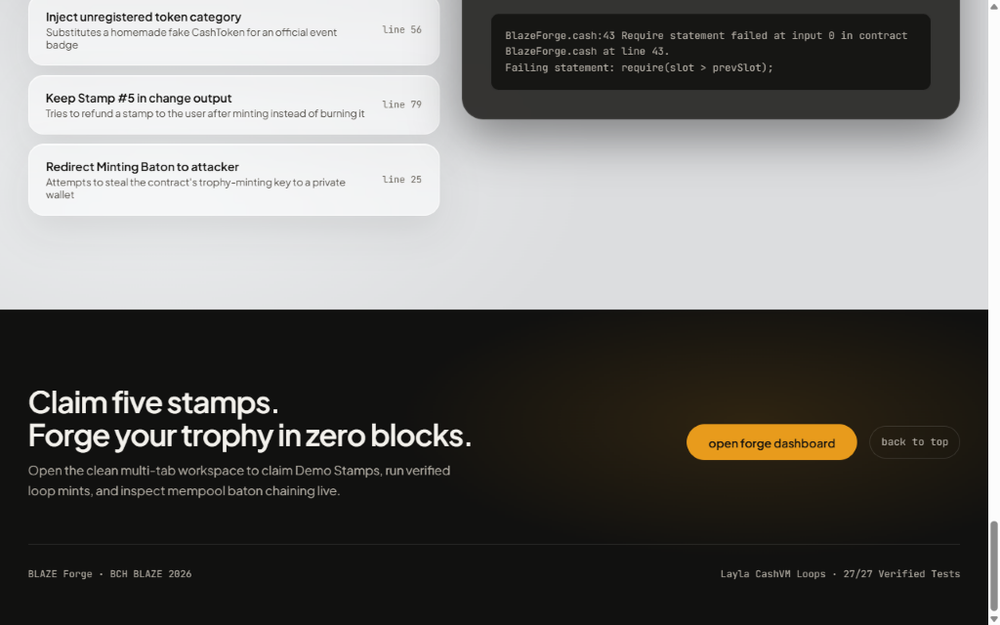
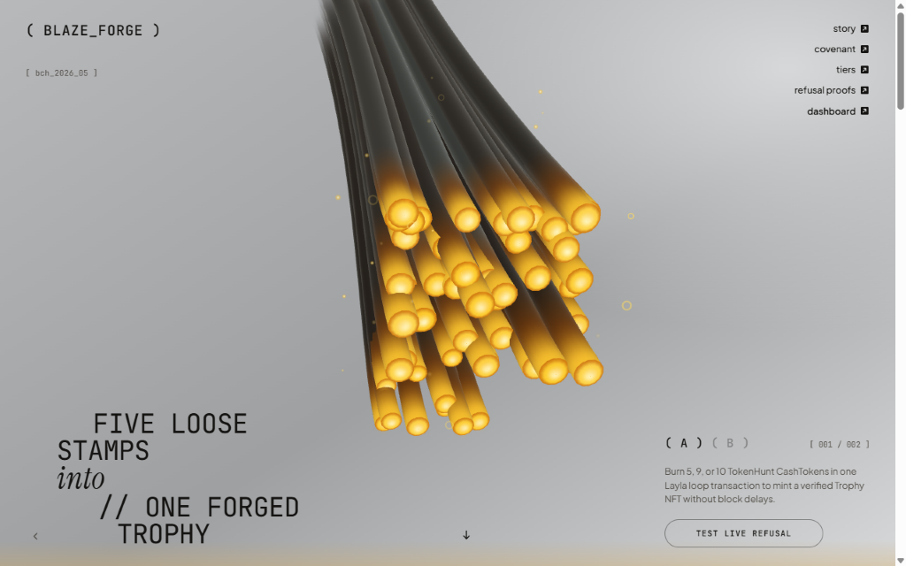
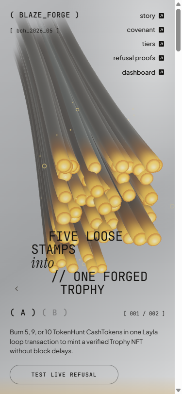
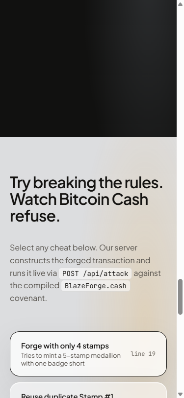
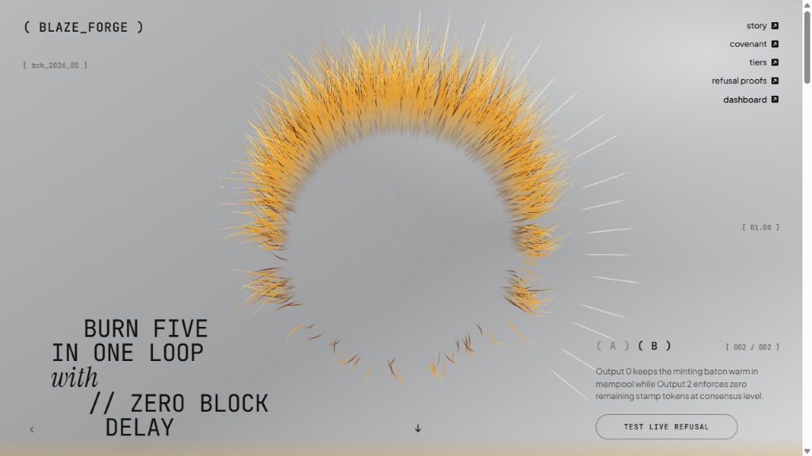
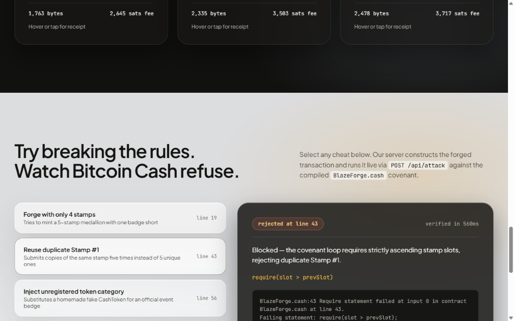
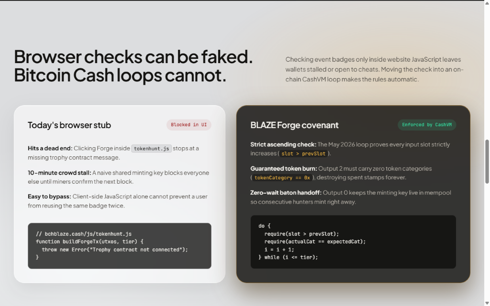
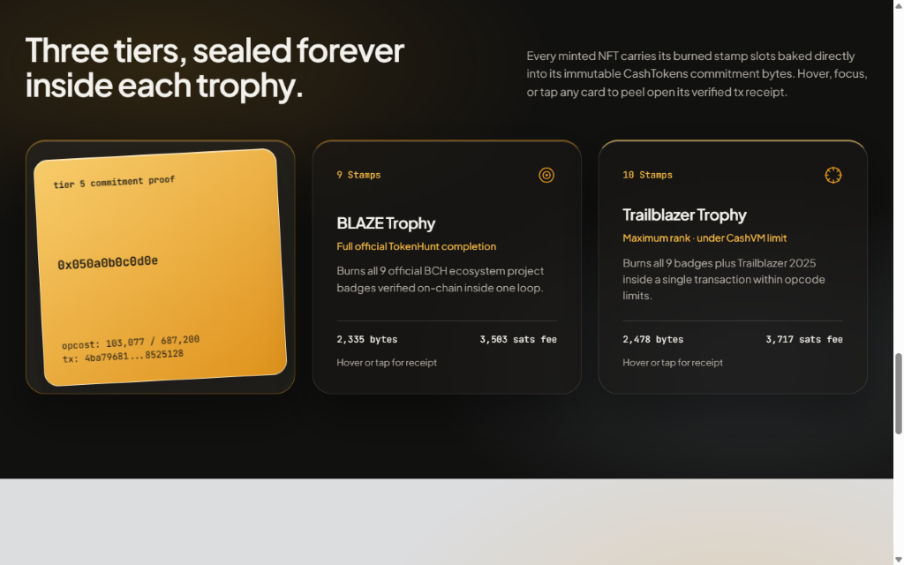
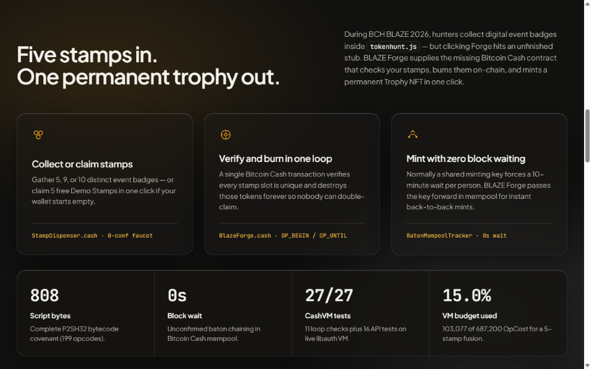
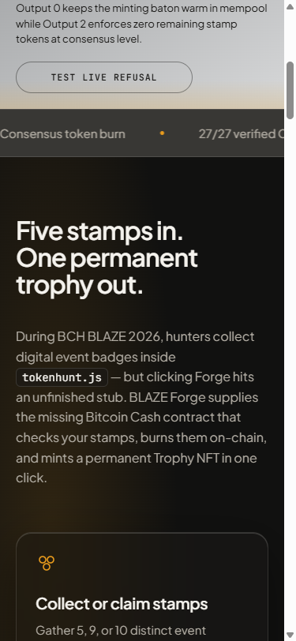

# Senior gap audit: BLAZE Forge

2026-11-19 · Stage assumed: Hackathon MVP / local pre-deployment demo running on `MockNetworkProvider` (no mainnet funds or live users yet) · Read fully: `contracts/BlazeForge.cash`, `contracts/StampDispenser.cash`, `src/index.ts`, `src/server.ts`, `src/artifacts.ts`, `src/registry.ts`, `src/buildForgeTx.ts`, `src/api/types.ts`, `src/api/idempotency.ts`, `src/api/service.ts`, `src/api/routes.ts`, `scripts/smoke.ts`, `scripts/generate-evidence.ts`, `scripts/plain-words-check.mjs`, `tests/forge.test.ts`, `tests/api.test.ts`, `package.json`, `tsconfig.json`, `vitest.config.ts`, `README.md`, `.gitignore`, `evidence/report.json`, `public/index.html`, `public/styles.css`, `public/app.js` · Checks run: `npx tsc --noEmit`, `npm run verify` (27/27 tests), `npm run smoke`, `npm run check:words`, `npm audit --omit=dev`, `npm audit`, `git log --stat`, `git status -s`, static hygiene & CSS metric scan, and live HTTP checks against `http://localhost:3000` · Screens inspected: `/` landing page (Hero States A & B, `#story`, `#covenant`, `#tiers`, `#proofs`, `footer`) at `1280×800` desktop and `375×812` mobile.

> This is a gap-finding self-check, not an assurance audit. Closing these gaps brings the app close to what a senior engineer and designer would build; it doesn't certify that it is secure, production-ready or well designed.

---

## Verdict

**Senior Engineer:** The heart of the project — the May 2026 Layla loop covenant (`BlazeForge.cash`), strict ascending slot verification, consensus token burn, and the 27-test real `libauth` CashVM verification suite — shows genuine technical depth rather than a frontend mock. However, three real API data/validation bugs slipped past the test suite, the API accepts raw private keys over HTTP while defaulting everything to an in-memory `MockNetworkProvider` with hardcoded faucet keys, and the repo has zero CI checks, environment config, or HTTP hardening headers. Under `senior-gap-audit` scoring rules, shipping primary navigation links straight into a raw JSON `404` alongside these boundary gaps caps the score right now.

**Senior Product Designer:** The desktop visual direction — full-bleed silver-grey studio lighting, custom Three.js fiber-to-iris graphics, restrained obsidian/silver alternating contrast bands, and plain-English + CashVM proof cards — rises well above generic template work. That good first impression breaks down when core actions fail: both the top-right `dashboard` nav link and the footer's bright gold primary CTA lead to an unstyled `404` JSON payload, low-contrast hero secondary labels fail WCAG AA minimums (`1.88:1`–`3.08:1`), mobile `375px` text collides with the 3D rods, and a reduced-motion shortcut silently breaks tapping Trophy cards.

**Engineering: 5/10 · Design: 5/10**

| Engineering area | Score | One-line reason |
|---|---|---|
| Security and access control | 4 | Raw private keys accepted over HTTP JSON, missing covenant input-index/commitment locks, wildcard CORS, and zero rate limits or security headers. |
| Data model and integrity | 5 | Three real bugs in `claimDemoStamps`, `forgeTrophy`, and `BatonMempoolTracker`, un-namespaced idempotency keys, plus 4 staging placeholder token categories. |
| Architecture and boundaries | 6 | Clean core-vs-API split undermined by 800-line/1,220-line files, duplicated `createServer` handlers, and undocumented triple route aliases. |
| Error handling and resilience | 5 | Insufficient stamps returns HTTP `500` instead of `422`, empty `catch {}` hides network errors, and raw internal error messages leak in JSON. |
| Testing and verification | 7 | Strong 27/27 real CashVM + API suite (`BCH_2026_05`) and smoke script, missing regression tests for the 3 API bugs and all frontend/DOM behavior. |
| Code hygiene and consistency | 5 | Clean `tsc --noEmit` with 0 `@ts-ignore`, offset by 16 `any` usages, private field `as any` hacks, uncommitted `public/` files, and untracked research clutter. |
| Performance | 6 | Real CashVM budget discipline (`15.0%`–`27.8%` OpCost) and GPU RAF pause off-screen, offset by unbounded idempotency `Map` and per-request VM construction on `/api/attack`. |
| Operations and delivery | 3 | Zero CI workflow (`.github/workflows`), no deploy manifest, no structured logging or request IDs, and conflicting script byte metrics between `/api/health` and UI. |
| Dependencies and configuration | 5 | Zero production vulnerabilities (`npm audit --omit=dev`), balanced by hardcoded `MockNetworkProvider`, `PORT`-only env config, `tsx` runtime dependency on `devDependencies`, and 2 critical devDep alerts. |
| Docs and developer experience | 5 | Clear API table and plain-words script, held back by stale test counts (`26/26` vs `27/27`), missing landing-page docs, and no `.env.example`. |
| Product and scope judgement | 5 | Strong on-chain enforcement core, but primary navigation and main footer CTA point to an unbuilt `/dashboard` returning raw JSON `404`. |

| Design and UX area | Score | One-line reason |
|---|---|---|
| Hierarchy and layout | 7 | Strong alternating dark/silver studio rhythm on desktop, weakened by a `175svh` hero runway and mobile headline overlap with 3D rods. |
| Typography | 6 | Effective monospace/sans/italic serif contrast, undermined by 20 distinct ad-hoc `font-size` rules and `11px` hero metadata tags. |
| Colour, contrast and theming | 5 | Crisp zero-raw-hex discipline outside `:root`, but measured hero secondary/ghost text falls below WCAG AA (`1.88:1`–`3.08:1`). |
| Component consistency | 5 | Deliberate gold sticker motif, undercut by 18 dead unused `:root` tokens (of 88), 7 radii values, 4 button treatments, and 22 `backdrop-filter` rules. |
| Navigation and information architecture | 4 | Emphasized `dashboard` nav link and gold footer CTA are broken dead-ends (`404` JSON), and no sticky nav exists past the fold. |
| Core flows and feedback | 4 | Visitors can run live exploit refusals (`POST /api/attack`), but cannot complete the actual stamp-claim or trophy-forge journey in the UI. |
| Forms and input | Not assessed | Current landing page contains no form controls; reassess once `/dashboard` claim and forge forms are implemented. |
| States: loading, empty, error, success | 5 | Good live VM loading indicator on attack buttons, offset by a race condition on rapid clicks, stale rule copy on error, and silent `/api/health` fallback. |
| Accessibility | 4 | Broken tap-to-open card stickers under `prefers-reduced-motion`, no skip link, sub-24px mobile nav tap targets, missing `aria-pressed` on attack pills, and contrast failures. |
| Responsive and mobile | 5 | Zero horizontal scroll overflow and clean `#story` stacking at `375×812`, offset by rod-over-text collision in mobile hero and off-screen receipt updates in `#proofs`. |
| Copy and microcopy | 7 | Clear dual-audience framing that demystifies CashVM rules in plain English, aside from promising an unbuilt multi-tab `/dashboard` workspace. |

---

## Fix first

Ordered by combined risk and user impact across Engineering and Design.

1. **[Design + Engineering] Broken `/dashboard` primary CTA and nav link (`404` JSON dead end)** — **Critical** · Effort: **S** (remove/replace link until built) or **L** (build `/dashboard`)
   - *What's wrong:* Both the emphasized top-right hero link (`dashboard ↗`) and the bright gold primary CTA in the footer (`open forge dashboard`) link to `/dashboard`, which does not exist and dumps users onto an unstyled raw JSON `404` response.
   - *Why a senior cares:* A visitor clicking the loudest action button on a page expects the product's core workflow, not a backend error payload. Leaving half-wired navigation in production routes destroys credibility immediately.
   - *Evidence:* `public/index.html:45`, `public/index.html:446`, `src/api/routes.ts:386`; `curl.exe -s -i http://localhost:3000/dashboard` returns `HTTP/1.1 404 Not Found` with `{"error":{"code":"NOT_FOUND","message":"Route GET /dashboard not found"}}`; .
   - *Fix:* Either implement `/dashboard` wired to `/api/stamps/claim` and `/api/forge`, or until it is ready, remove `/dashboard` from hero/footer navigation and add an explicit HTML `404` page handler for browser requests.

2. **[Engineering] Three live API correctness bugs in claim metadata, explicit-UTXO fee funding, and HTTP `422` validation** — **High** · Effort: **S**
   - *What's wrong:* First, `claimDemoStamps` maps minted stamps `[1..5]` against official slots `1..5` (e.g., `template-titan`, `selene-sorcerer`) instead of Demo Stamp slots `10..14`. Second, `forgeTrophy` calls `ensureFeeUtxos()` and fetches `refreshedUtxos`, then discards them whenever the caller supplies `req.utxos`, causing dust-only token UTXOs to fail fee payment. Third, forging without enough stamps throws a `Need N distinct registered stamps...` error that doesn't match the route's string check, returning HTTP `500` instead of `422`.
   - *Why a senior cares:* Clients and wallets reading API responses receive false badge identities, valid client UTXO lists fail unexpectedly, and ordinary user input errors pollute `500` error alerts.
   - *Evidence:* `src/api/service.ts:321-331` vs `src/registry.ts:137-155`; `src/api/service.ts:363-388`; `src/api/routes.ts:348` vs `src/buildForgeTx.ts:502`.
   - *Fix:* Map Demo Stamps against `slots.filter(s => s.kind === 'demo')` (`slots 10..14`); merge pure-BCH `feeUtxos` cleanly into `buildForgeTx` when `req.utxos` is provided; throw a typed `ForgeValidationError` (HTTP `422`) rather than fragile substring matching.

3. **[Engineering] Remove raw private keys over HTTP, add env-driven provider config, and lock covenant input index & baton commitment** — **High** · Effort: **M**
   - *What's wrong:* `POST /api/forge` accepts raw hex private keys (`signerPrivKeyHex`) in the JSON body (`src/api/types.ts:99`) and hashes them inside `IdempotencyStore`; `BlazeBackendService` hardcodes `MockNetworkProvider` (`src/api/service.ts:81`) and a fixed faucet key (`src/api/service.ts:61`); and neither `.cash` covenant locks `this.activeInputIndex == 0` or `tx.outputs[0].nftCommitment == 0x`.
   - *Why a senior cares:* Server APIs must never ask users for raw private keys (especially once wired to real funds — signing belongs in client wallets via WalletConnect `wcTransaction`), and missing `activeInputIndex == 0` / empty-commitment checks on CashScript covenants let attackers piggyback extra contract UTXOs or bloat the shared minting baton's 40-byte commitment.
   - *Evidence:* `src/api/types.ts:95-101`, `src/api/service.ts:61,81,375`, `contracts/BlazeForge.cash:17-30`, `contracts/StampDispenser.cash:7-26`.
   - *Fix:* Gate `signerPrivKeyHex` behind a test-only dev flag and return unsigned `wcTransaction` payloads for real browsers; add startup env config (`BCH_NETWORK`, `ELECTRUM_HOST`, `FORGE_CATEGORY`) validated with clear fail-fast errors; add `require(this.activeInputIndex == 0);` and `require(tx.outputs[0].nftCommitment == 0x);` to both contracts and recompile artifacts.

4. **[Design] Fix hero WCAG AA contrast failures and `375×812` mobile headline collision over 3D rods** — **High** · Effort: **S**
   - *What's wrong:* Key text elements on the light-grey studio hero fail WCAG contrast ratios (`1.88:1` on inactive `( B )` switcher, `3.08:1` on `.hero-lead` over the bottom gradient, `4.01:1` on `--text-ink-subtle` over `#dcdddf`), hero nav tap targets have only `2px` padding (`~20px` height), and on mobile `375×812` the 3D optical rods cut directly behind the black `FIVE LOOSE STAMPS` display text and `[ bch_2026_05 ]`.
   - *Why a senior cares:* Low-contrast controls and overlapping text-over-3D elements make the hero hard to read outdoors or on lower-brightness screens and create mis-taps on phones.
   - *Evidence:* `public/styles.css:25-27,254-279,470-480,1461-1485`;  and .
   - *Fix:* Darken `--text-ink-ghost` (`>= 4.5:1` / `>= 3:1` large), `--text-ink-muted`, and `--text-ink-subtle`; expand mobile `.hero-nav-link` hit areas to `>= 44×44px`; lower `.iris-canvas` opacity or push `.iris-canvas` scale/offset upward in `@media (max-width: 900px)` so mobile headlines sit over clean background tone.

5. **[Design + Engineering] Fix `prefers-reduced-motion` sticker click bug, `/api/attack` race condition, and mobile receipt scroll jump** — **Medium** · Effort: **S**
   - *What's wrong:* In `initScrollChoreography()`, enabling `prefers-reduced-motion` returns early at line `1092`, skipping the `.tier-card` click listeners (`:1115`) so keyboard/touch users who disable motion cannot tap open Trophy receipts. In `initBackendProofs()`, rapid clicks race without `AbortController`, errors leave the previous attack's `require(...)` line visible, `retry` is plain text instead of a button, and on mobile `#proofs` updates happen silently below the fold (`~500px` below the tapped button).
   - *Why a senior cares:* Accessibility settings should reduce motion, not break interactive controls; async UI without request cancellation shows mismatched responses to fast clickers.
   - *Evidence:* `public/app.js:1085-1122`, `public/app.js:1161-1214`, `public/index.html:379-417`; .
   - *Fix:* Register `.tier-card` click + `Enter`/`Space` handlers outside the `REDUCED_MOTION` branch and add `role="button"` + `aria-expanded`; add `AbortController` + clear stale `#receipt-rule` on error + wire a real retry button; scroll smoothly into view (or render compact inline result under the selected mobile button) on small viewports.

6. **[Engineering] Add HTTP hardening, CI pipeline, fix idempotency namespace/memory bounds, and clean repo clutter** — **Medium** · Effort: **M**
   - *What's wrong:* `IdempotencyStore` lets keys collide across routes (`/api/stamps/claim` vs `/api/forge`), grows in memory without a cap, and scans all entries on every request; `parseJsonBody()` checks string characters instead of bytes, doesn't `destroy()` oversized streams, and returns `400` instead of `413`; HTTP responses set wildcard CORS (`*`) and zero security headers (`CSP`, `X-Content-Type-Options`, `X-Frame-Options`); `HEAD /` returns `404`; there is no CI workflow; and 5 untracked research directories/files + uncommitted `public/` work sit in the working tree.
   - *Why a senior cares:* Without automated CI checks, unbounded caches or unguarded request parsers are the first things to fail under public traffic, and cluttered untracked scraping files make repo handover confusing.
   - *Evidence:* `src/api/idempotency.ts:21-94`, `src/api/routes.ts:71-149,174,189-380`, `.gitignore:1-5`, `git status -s` (`M package.json`, `M src/api/routes.ts`, `?? public/`, `?? bchblaze_cash.html`, `?? corpus/`, `?? graphify-out/`, `?? site_pages/`, `?? user-research/`).
   - *Fix:* Namespace idempotency keys by `${method}:${pathname}:${key}` with an LRU/max-size cap; fix `parseJsonBody` byte checks + `413` + `req.destroy()`; add `HEAD` support, restricted CORS, security headers, and basic rate limiting; add `.github/workflows/ci.yml` running `tsc --noEmit`, `verify`, `smoke`, and `check:words`; commit clean code and move/ignore local research captures.

---

## Engineering findings

### 1. Security and access control

- **Raw private keys accepted in HTTP JSON request body** · **High** · Tell?: No · Effort: **M**
  - *Finding:* `POST /api/forge` accepts a hex private key (`signerPrivKeyHex`) over HTTP (`src/api/types.ts:99`) and constructs `SignatureTemplate` on the server (`src/api/service.ts:375-376`), then JSON-serializes and hashes the request body containing that private key in `IdempotencyStore.hashPayload` (`src/api/routes.ts:311`). Accepting user private keys server-side breaks non-custodial wallet security the moment the app connects to a real network.
  - *Evidence:* `src/api/types.ts:95-101`, `src/api/service.ts:374-377`, `src/api/routes.ts:309-312`.
  - *Fix:* Allow `signerPrivKeyHex` strictly when `NODE_ENV === 'test'`; in live/browser mode, return only unsigned `wcTransaction` objects so signing never leaves the user's wallet.

- **Missing input-index and empty-commitment guards inside both CashScript contracts** · **Medium** · Tell?: No · Effort: **S**
  - *Finding:* Neither `BlazeForge.cash` nor `StampDispenser.cash` asserts `require(this.activeInputIndex == 0);` or `require(tx.outputs[0].nftCommitment == 0x);`. Without locking `activeInputIndex == 0`, spending two contract-locked dust UTXOs together can confuse script introspection expectations; without locking output 0's NFT commitment to empty (`0x`), any caller of `forge()` or `claim5()` can attach 40 bytes of arbitrary spam onto the shared contract minting baton permanently.
  - *Evidence:* `contracts/BlazeForge.cash:24-30` and `contracts/StampDispenser.cash:9-16` (check `tokenCategory`, `lockingBytecode`, `tokenAmount`, `value`, but omit `activeInputIndex` and output `nftCommitment`).
  - *Fix:* Add `require(this.activeInputIndex == 0);` and `require(tx.outputs[0].nftCommitment == 0x);` in both contracts and recompile `artifacts/*.json`.

- **Wildcard CORS, zero HTTP security headers, and zero rate limiting** · **Medium** · Tell?: No · Effort: **S**
  - *Finding:* Every JSON and preflight response sets `Access-Control-Allow-Origin: *` (`src/api/routes.ts:76,143`), static HTML serves without `Content-Security-Policy`, `X-Content-Type-Options: nosniff`, `X-Frame-Options`, or `Referrer-Policy` (`src/api/routes.ts:55-61`), and CPU-heavy mutation/VM routes (`/api/attack`, `/api/forge`, `/api/stamps/claim`) have no rate limit — each `POST /api/attack` spins up a fresh `MockNetworkProvider`, builds keys, and runs `builder.send()` (`~300-900ms` per request in `vitest` output).
  - *Evidence:* `src/api/routes.ts:55-80,141-150`, `src/buildForgeTx.ts:609-655`, `tests/api.test.ts` run timings (`311ms–911ms` per `/api/attack`).
  - *Fix:* Restrict CORS via `ALLOWED_ORIGIN` env var, add standard security headers on HTML and JSON responses, and add an IP token-bucket rate limiter on `POST` routes.

- **Raw internal error strings leaked in `500` JSON responses** · **Medium** · Tell?: No · Effort: **S**
  - *Finding:* Both `src/server.ts:36,60` and `src/api/routes.ts:258,349,380` echo raw `err.message` directly to HTTP clients on `500` failures, exposing file paths, dependency stack details, or internal UTXO errors.
  - *Evidence:* `src/server.ts:36,60` (`message: err?.message ?? ...`), `src/api/routes.ts:258,349,380`.
  - *Fix:* Log the full error server-side and return a safe static public message for `500` responses while keeping specific validation messages for `4xx` user errors.

- **Hardcoded faucet private key (`00...09`) embedded in source** · **Medium** · Tell?: Yes (Magic values) · Effort: **S**
  - *Finding:* `DEFAULT_FAUCET_PRIVKEY = '00'.repeat(31) + '09'` is hardcoded in `src/api/service.ts:61` (and `'00'.repeat(31) + '09'` / `'07'` repeated in `src/buildForgeTx.ts:624`, `scripts/smoke.ts:40`, `scripts/generate-evidence.ts:20`). While harmless in offline mock tests, falling back to a known public-source key on Chipnet/Mainnet would let anyone drain the faucet.
  - *Evidence:* `src/api/service.ts:61,95`, `src/buildForgeTx.ts:624`, `scripts/smoke.ts:40`.
  - *Fix:* Require `FAUCET_PRIVKEY_HEX` from env outside `MockNetworkProvider` and remove silent default fallback on non-mock networks.

### 2. Data model and integrity

- **Real Bug: `claimDemoStamps()` returns official TokenHunt slot numbers & names (`1..5`) instead of Demo Stamps (`10..14`)** · **High** · Tell?: No · Effort: **S**
  - *Finding:* `claimDemoStamps()` iterates `[1, 2, 3, 4, 5]` and looks up `this.slots.find((s) => s.slot === slotNum)` (`src/api/service.ts:321-331`). In `createBlazeTokenHuntRegistry()`, slots `1..5` are official badges (`template-titan`, `selene-sorcerer`, `showcase-showoff`, `consensus-contributor`, `hidden-6`), whereas Demo Stamps live at slots `10..14` (`src/registry.ts:137-155`). The API mints the right Demo Stamp NFTs on-chain, then returns lying metadata saying the user received official badges `slot: 1..5`.
  - *Evidence:* `src/api/service.ts:321-331` vs `src/registry.ts:39-66,146-153` vs `tests/forge.test.ts:132` (`burnedSlots` reports `[10, 11, 12, 13, 14]`).
  - *Fix:* Look up `this.slots.filter((s) => s.kind === 'demo')` (`slot: 10..14`) or match by `demoCategory` + `commitmentRule === slotNum`.

- **Real Bug: `forgeTrophy()` discards `feeUtxos` when caller supplies explicit `req.utxos`** · **High** · Tell?: No · Effort: **S**
  - *Finding:* `forgeTrophy()` fetches `ensureFeeUtxos(recipient, 25000n)` and `refreshedUtxos` (`src/api/service.ts:370-371`), then sets `allUtxos = req.utxos ? availableUtxos : refreshedUtxos...` (`line 372`) and never passes `feeUtxos` to `buildForgeTx()` (`lines 379-388`). Real TokenHunt stamps are often dust UTXOs (`1000`–`1500` sats), so passing `req.utxos` drops the BCH needed to cover the `2645`–`3717` sat fee and trophy dust.
  - *Evidence:* `src/api/service.ts:363-388`, `src/buildForgeTx.ts:531-538`.
  - *Fix:* Pass pure-BCH `feeUtxos` separately into `buildForgeTx(..., { ..., feeUtxos })`, or append unused pure-BCH UTXOs when `req.utxos` has insufficient satoshis.

- **Idempotency keys are not scoped per HTTP route/method** · **Medium** · Tell?: No · Effort: **S**
  - *Finding:* `IdempotencyStore.claim(idempotencyKey, hash)` (`src/api/routes.ts:222,312`) stores keys in a single global `Map` with no route or method prefix. Sending the same `Idempotency-Key` to `POST /api/stamps/claim` and then `POST /api/forge` collides and falsely triggers `422 IDEMPOTENCY_PAYLOAD_MISMATCH` or replays the wrong response type.
  - *Evidence:* `src/api/idempotency.ts:21,36-64`, `src/api/routes.ts:222,312`.
  - *Fix:* Scope cache key to `${method}:${canonicalEndpoint}:${idempotencyKey}`.

- **`BatonMempoolTracker` sets `zeroConfChained` from global map size instead of per-contract state** · **Medium** · Tell?: No · Effort: **S**
  - *Finding:* Line `182` of `src/buildForgeTx.ts` returns `zeroConfChained: Boolean(this.pending.size > 0)` even when resolving a completely different contract whose live UTXO came directly from on-chain state.
  - *Evidence:* `src/buildForgeTx.ts:159-183`.
  - *Fix:* Return `zeroConfChained: false` when falling through past `this.pending.get(contractTokenAddress)` (line `182`), and `true` only inside lines `167` and `171` where a tracked unconfirmed baton matched or bridged.

- **Hardcoded `estimatedFeeSats: 1500` in claim receipt and 4 staging placeholder token categories** · **Low** · Tell?: Yes (Magic values) · Effort: **S**
  - *Finding:* `claimDemoStamps()` hardcodes `estimatedFeeSats: 1500` (`src/api/service.ts:346`) instead of surfacing `claim`'s computed fee from `finalizeBuiltBatonTx`, and `OFFICIAL_TOKENHUNT_CATALOG` (`src/registry.ts:51-85`) contains 4 placeholder categories (`0404...`, `0606...`, `0707...`, `0909...`) for organizers' pending slots.
  - *Evidence:* `src/api/service.ts:346`, `src/registry.ts:51-85`.
  - *Fix:* Expose `feeSats` on `BuiltClaimTx` like `BuiltForgeTx` does, and replace placeholder category IDs before any mainnet deployment.

### 3. Architecture and boundaries

- **Giant single-file modules (`src/buildForgeTx.ts` at 800 lines, `public/app.js` at 1,220 lines)** · **Medium** · Tell?: Yes (Giant files) · Effort: **M**
  - *Finding:* `src/buildForgeTx.ts` mixes CashScript contract instantiation, UTXO normalization, mempool baton state tracking, transaction building for both contracts, and the 5-vector adversarial attack harness in one 800-line file. Similarly, `public/app.js` puts custom procedural WebGL shaders, physics particles, hero copy switching, scroll choreography, and backend fetch wiring in one 1,220-line file.
  - *Evidence:* Measured line counts (`src/buildForgeTx.ts`: 800 lines; `public/app.js`: 1,220 lines; `public/styles.css`: 1,599 lines).
  - *Fix:* Split `src/buildForgeTx.ts` into `batonTracker.ts`, `utxo.ts`, `txBuilders.ts`, and `adversarial.ts`; split `public/app.js` into `iris-scene.js` and `page-ui.js`.

- **Duplicated HTTP `createServer` wrapper and undocumented triple route aliases** · **Medium** · Tell?: Yes (Several solutions / prompt drift) · Effort: **S**
  - *Finding:* `createBlazeServer()` (`src/server.ts:24-43`) and `startServer()` (`src/server.ts:45-66`) copy-paste the exact same 17-line `createServer` + `try/catch` block rather than reusing `createBlazeServer()`, and `src/api/routes.ts` silently accepts 2–3 undocumented aliases per endpoint (`/api/stamps/claim`, `/api/claim-stamps`, `/claim-stamps` at `:182-184`; `/api/forge` and `/forge` at `:264`; `/api/health` and `/health` at `:153`). Meanwhile `HEAD /` falls through to `404` because line `174` only checks `method === 'GET'`.
  - *Evidence:* `src/server.ts:24-66`, `src/api/routes.ts:153-185,264,355`, `curl.exe -s -i -I http://localhost:3000/` → `404 Route HEAD / not found`.
  - *Fix:* Reuse `createBlazeServer()` inside `startServer()`, support `HEAD` on `GET` static/health routes cleanly, and settle on one canonical `/api/...` prefix.

### 4. Error handling and resilience

- **Real Bug: Insufficient stamps returns `500 FORGE_FAILED` instead of `422`** · **Medium** · Tell?: No · Effort: **S**
  - *Finding:* `src/api/routes.ts:348` classifies errors using `err.message.includes('Insufficient') || err.message.includes('No matching')`, whereas `src/buildForgeTx.ts:502` throws `Need ${tier} distinct registered stamps to forge ...`. Neither word matches, so normal user validation failures return `500 FORGE_FAILED`.
  - *Evidence:* `src/api/routes.ts:348-349` vs `src/buildForgeTx.ts:501-503`.
  - *Fix:* Introduce a small `ValidationError` subclass with `statusCode = 422` and check `err instanceof ValidationError`.

- **Silent `catch {}` blocks in `getBatonStatus()` mask provider failures as `'none'`** · **Medium** · Tell?: Yes (Swallowed errors) · Effort: **S**
  - *Finding:* `src/api/service.ts:259` and `:272` catch all exceptions without checking whether the error is "no baton UTXO found" vs an Electrum timeout or JSON parse crash, silently reporting `currentBatonOutpoint: 'none'`.
  - *Evidence:* `src/api/service.ts:250-275`.
  - *Fix:* Inspect missing-baton conditions explicitly or check `matching.length === 0` without throwing so genuine network failures bubble up as `503`/`500`.

- **`parseJsonBody()` uses UTF-16 string length, never destroys oversized streams, and returns `400` instead of `413`** · **Medium** · Tell?: No · Effort: **S**
  - *Finding:* `src/api/routes.ts:101-106` concatenates chunks into a string and rejects after `raw.length > 2 * 1024 * 1024` without calling `req.destroy()`, leaving a multi-megabyte body streaming in memory and mapping both `Payload too large` and malformed JSON to `400 BAD_REQUEST` (`:190,269,360`).
  - *Evidence:* `src/api/routes.ts:99-121,189-191,268-270,359-361`.
  - *Fix:* Count actual bytes (`Buffer.byteLength`), call `req.destroy()` immediately on overflow, reject with a typed `PayloadTooLargeError`, and return HTTP `413` with a tight limit (`64KB` or `256KB` for forge payloads).

### 5. Testing and verification

- **All 27 CashVM & API tests currently execute against real `libauth` (`BCH_2026_05`), but omit key negative & metadata assertions** · **Medium** · Tell?: No · Effort: **S**
  - *Finding:* `npm run verify` runs 27 real assertions (`tests/forge.test.ts` 11, `tests/api.test.ts` 16) plus `npm run smoke` and `npm run check:words` cleanly (`0` exit codes). However, tests never assert `stamp.slot` / `stamp.name` in `POST /api/stamps/claim` (`tests/api.test.ts:102-103` only checks `.commitment`), never test `POST /api/forge` with explicit `req.utxos`, never test insufficient-stamps `422`, and never check frontend DOM behavior (`prefers-reduced-motion`, mobile viewport, `/dashboard` target).
  - *Evidence:* `vitest` run output (`27 passed (27)` across `tests/api.test.ts` and `tests/forge.test.ts`), `tests/api.test.ts:102-105,306-336`.
  - *Fix:* Add regression tests for Demo Stamp slot numbers (`10..14`), explicit `req.utxos` fee handling, insufficient-stamp `422`, cross-route `Idempotency-Key`, and a lightweight Playwright/jsdom check for hero nav links and attack UI state.

### 6. Code hygiene and consistency

- **Type escapes (`16` `any` usages + `1` `as unknown as`) peeking into private fields, plus stale fallback constants** · **Medium** · Tell?: Yes (Type escapes) · Effort: **S**
  - *Finding:* Static scan shows `10` `catch (err: any)` handlers (`src/server.ts:29,53`, `src/api/routes.ts:189,207,254,268,286,344,359,379`), `6` `as any` casts (`src/api/service.ts:195-199,224,287`), and `1` `as unknown as` (`src/api/service.ts:372`). Worse, `:224` and `:287` use `(this.batonTracker as any).pending?.size` to bypass `private pending` encapsulation, while `:197` and `:200` fall back to stale hardcoded sizes (`233` and `90`) that predate the current `276` and `85` byte contracts.
  - *Evidence:* Static hygiene grep across `src/`; `src/api/service.ts:195-200,224,287,372`; `tests/api.test.ts:49,56` (`276` and `85`).
  - *Fix:* Expose a typed `pendingCount()` getter on `BatonMempoolTracker`, replace `catch (err: any)` with `catch (err: unknown)` + `getErrorMessage(err)`, and type `Artifact` `debug` properly.

- **Stale tier terminology in route validation & uncommitted/cluttered workspace** · **Low** · Tell?: Yes (Prompt drift + giant commits) · Effort: **S**
  - *Finding:* `src/api/routes.ts:302` rejects invalid tiers with `Must be 5 (Bronze), 9 (Silver), or 10 (Gold)`, contradicting `TROPHY_TIERS` (`BLAZE Medallion`, `BLAZE Trophy`, `Trailblazer Trophy`). No ESLint or Prettier config exists. Git history consists of 4 large batch commits (`1,358`–`2,322` lines each), while the entire landing page (`public/`) and route changes sit uncommitted alongside 5 untracked research folders/files (`bchblaze_cash.html`, `corpus/`, `graphify-out/`, `site_pages/`, `user-research/`).
  - *Evidence:* `src/api/routes.ts:302` vs `src/registry.ts:20-24`; `git status -s`; `git log --stat --oneline -10`.
  - *Fix:* Update the tier validation error string, add ESLint + Prettier, commit the working code cleanly, and move or `.gitignore` temporary research captures.

### 7. Performance

- **Unbounded `IdempotencyStore` `Map` with `O(N)` full-map scan on every `claim()`** · **Medium** · Tell?: No · Effort: **S**
  - *Finding:* `IdempotencyStore` (`src/api/idempotency.ts:21,36-37,87-94`) iterates every record in memory to prune `24h`-old keys on every write and imposes no maximum entry count, allowing unauthenticated requests with unique `Idempotency-Key` headers to grow heap indefinitely until OOM.
  - *Evidence:* `src/api/idempotency.ts:21-94`.
  - *Fix:* Add a max entry cap (evicting oldest entries via `Map` insertion order) and prune lazily or on an interval instead of scanning every `claim()`.

- **Unthrottled full-world VM initialization on every `POST /api/attack` and 22 `backdrop-filter` glass layers** · **Low** · Tell?: No · Effort: **S**
  - *Finding:* Each `/api/attack` HTTP hit rebuilds `MockNetworkProvider`, compiles/instantiates `BlazeForge`, derives keys, and runs `builder.send()` (`~300-900ms`, `src/buildForgeTx.ts:609-655`) without caching or rate-limiting. On the frontend, `public/styles.css` declares `backdrop-filter` `22` times, which can tax lower-end mobile GPUs alongside Three.js (mitigated partially by the `IntersectionObserver` sleep loop).
  - *Evidence:* `src/buildForgeTx.ts:609-655`, CSS metric count (`22` `backdrop-filter` declarations).
  - *Fix:* Add lightweight IP rate-limiting or short TTL result cache per static `attackType`, and verify mobile frame pacing on physical phones.

### 8. Operations and delivery

- **No CI workflow, deployment config, structured logging, or error tracking** · **High** · Tell?: Yes (Repo hygiene) · Effort: **M**
  - *Finding:* There is no `.github/workflows/` directory, no `Dockerfile` / `vercel.json` / deployment config, no error reporter, and only 6 plain `console.log`/`console.error` startup/shutdown lines (`src/server.ts:101-115`). HTTP requests, latency, and `500` stack traces go unlogged.
  - *Evidence:* `git status -s`, `src/server.ts:101-115`, absence of `.github/`.
  - *Fix:* Add a GitHub Actions workflow running `tsc --noEmit`, `npm run verify`, `npm run smoke`, and `npm run check:words`; add structured JSON request/error logging with request IDs before deployment.

- **Conflicting script size and opcode figures between `/api/health` and UI / `evidence/report.json`** · **Medium** · Tell?: Yes (Inconsistent truth across prompts) · Effort: **S**
  - *Finding:* `GET /api/health` reports `BlazeForge` as `276` bytes / `266` opcodes (`src/api/service.ts:195-210`, tested at `tests/api.test.ts:49-50`), whereas `evidence/report.json:7-8` and `#story` (`public/index.html:169,173`) report `808` bytes / `199` opcodes (`debug.bytecode` raw unparameterized template vs P2SH32 instantiated locking script with packed 495-byte registry constructor args). Presenting two unexplained numbers side by side confuses technical reviewers.
  - *Evidence:* `src/api/service.ts:195-210`, `tests/api.test.ts:49-50` vs `evidence/report.json:7-8` and `public/index.html:169-173`.
  - *Fix:* Expose both `templateBytecodeBytes` and `redeemScriptBytes` (with P2SH32 opcode count) clearly in `/api/health` so numbers reconcile cleanly.

### 9. Dependencies and configuration

- **Hardcoded `MockNetworkProvider`, single env var (`PORT`), runtime `tsx` reliance, and 2 critical `vitest` devDependency alerts** · **High** · Tell?: No · Effort: **M**
  - *Finding:* `BlazeBackendService` defaults strictly to `MockNetworkProvider` (`src/api/service.ts:80-81`) with no env var (`BCH_NETWORK`, `ELECTRUM_HOST`), no `.env.example`, and no config validator (`PORT` in `src/server.ts:46,99` is the only env var read anywhere). Additionally, `package.json:8` defines `"start": "tsx src/server.ts"` using `tsx` from `devDependencies` (`:23`) instead of running compiled `dist/server.js`, so `npm install --omit=dev && npm start` fails in production. Meanwhile, production dependencies report `0` vulnerabilities (`npm audit --omit=dev`), while `npm audit` reports `2` critical (`tinypool <=2.1.1`) and `1` moderate (`@vitest/mocker <=4.1.11`) advisories in dev-only `vitest@3.x` (`vitest@5.1.1` fix is breaking).
  - *Evidence:* `package.json:8-26`, `src/api/service.ts:80-81`, `src/server.ts:46,99`, `npm audit --omit=dev` (`found 0 vulnerabilities`), `npm audit` (`3 vulnerabilities (1 moderate, 2 critical)`).
  - *Fix:* Add typed startup env validation + `.env.example` supporting Chipnet Electrum; compile `"start": "node dist/server.js"` (`prestart`: `npm run build`); evaluate upgrading `vitest` to clear dev advisories cleanly.

### 10. Docs and developer experience

- **`README.md` is out of date (`26/26` tests, no landing page / Three.js documentation, no `.env.example`)** · **Low** · Tell?: Yes (Repo hygiene) · Effort: **S**
  - *Finding:* `README.md:4,60` still advertises `26/26` passing tests when the suite now runs `27/27`, and makes no mention of `public/`, the Three.js hero (`three`), or the planned `/dashboard` status, even though static page routes now fail/serve on `npm start`.
  - *Evidence:* `README.md:1-65` vs `tests/api.test.ts` + `tests/forge.test.ts` (`27` tests total) and `package.json`.
  - *Fix:* Update test counts, document frontend architecture and build steps, and add `.env.example` once env config is introduced.

### 11. Product and scope judgement

- **Primary navigation and footer CTA ship live links to an unbuilt `/dashboard` (`404`)** · **Critical** · Tell?: Yes (Dead ends) · Effort: **S** (remove/gate link) or **L** (ship `/dashboard`)
  - *Finding:* The landing page explains the mechanism cleanly and lets visitors test real `POST /api/attack` refusals, but the top navigation (`dashboard ↗`) and primary gold footer button (`open forge dashboard`) point to `/dashboard` (`public/index.html:45,446`), which returns raw JSON `404` (`src/api/routes.ts:386`). Leaving unimplemented links in primary CTAs violates basic shipping discipline even when intentionally deferred.
  - *Evidence:* `public/index.html:45,446`, `curl.exe -s -i http://localhost:3000/dashboard`.
  - *Fix:* Remove `/dashboard` links (or point them to `#proofs` / a clear `"coming next"` state) until `/dashboard` is actually implemented.

---

## Design and UX findings

### 1. Hierarchy and layout

- **3D fiber rods overlap mobile hero typography at `375×812` and desktop hero burns `175svh` before scrolling content** · **High** · Tell?: No · Effort: **S**
  - *Finding:* On mobile (`375×812`), `.hero-headline-slot` pushes the headline down (`padding-top: 190px`, `public/styles.css:1484`), yet the Three.js optical rods extend right through `FIVE LOOSE STAMPS`, lowering contrast and readability across the glowing tips. Meanwhile on desktop, `.hero-scroll-stage` spans `175svh` (`public/styles.css:178`) purely to drive the A->B scroll morph before any supporting section appears.
  - *Evidence:*  and ; `public/styles.css:178,1461-1485`.
  - *Fix:* In `@media (max-width: 900px)`, dial down `.iris-canvas` opacity/scale or anchor the camera slightly higher above the headline safe zone; trim desktop `.hero-scroll-stage` height (`~135svh`) or keep the `( A ) / ( B )` switch fast so first-time visitors reach `#story` sooner.

### 2. Typography

- **20 distinct ad-hoc `font-size` declarations across one landing page and tiny `11px` metadata tags** · **Medium** · Tell?: Yes (Random values) · Effort: **S**
  - *Finding:* CSS analysis measured `20` distinct `font-size` values in `public/styles.css` (`16px`, `0.6875rem`, `0.72rem`, `0.75rem`, `0.78rem`, `0.8125rem`, `0.875rem`, `0.9375rem`, `1rem`, `1.05rem`, `1.0625rem`, `1.25rem`, `1.375rem`, `2.25rem`, three separate `clamp()` headings, plus `0.85em`/`0.875em`/`1.18em` overrides). Metadata tags (`[ bch_2026_05 ]`, `[ 001 / 002 ]`) sit at `0.6875rem` (`11px`). Note on the positive side: only `3` distinct font weights (`400`, `500`, `600`) are used.
  - *Evidence:* CSS scan of `public/styles.css`; `public/styles.css:256,311` (`0.6875rem`).
  - *Fix:* Consolidate to a strict 6–7 token type scale (`--text-xs` min `12px`/`0.75rem` through `--text-display`) so hierarchy stays sharp across every band.

### 3. Colour, contrast and theming

- **WCAG AA contrast failures on hero secondary/ghost text and muted silver labels** · **High** · Tell?: No · Effort: **S**
  - *Finding:* Four text tokens fall below WCAG AA (`4.5:1` normal text, `3.0:1` large/UI components) against their rendered studio backgrounds:
    - Inactive switcher `( B )` (`--text-ink-ghost: rgba(20, 19, 17, 0.34)`) measures **`1.88:1`** over bottom-right `#9d9ea0` (and **`2.00:1`** over `#b8b9bb`).
    - `.hero-lead` & `[ 01.00 ]` (`--text-ink-muted: #524e48`) over lower `#9ea0a2` grey measures **`3.08:1`** (`13px` body copy requires `4.5:1`).
    - `--text-ink-subtle` (`#6e6961`) used on `.attack-btn-tag` (`line 19`, `12px`) over `#dcdddf` measures **`4.01:1`** (just below `4.5:1`).
    - Positive contrast check: `--text-ink` (`#141311`) on `--accent-gold` (`#e89b1c`) achieves **`8.08:1`**, `--text-on-dark-muted` (`#b0aba2`) on obsidian (`#111110`) achieves **`8.27:1`**, and CSS outside `:root` contains `0` raw hex/rgba overrides.
  - *Evidence:* Computed WCAG luminance ratios; ; ; `public/styles.css:24-27,254-258,470-480,503-507,1252`.
  - *Fix:* Darken `--text-ink-ghost` opacity to `>= 0.72` (plus subtle underline/bracket weight distinction for active state instead of near-invisible grey), shift `.hero-lead` to `--text-ink` (`>= 7:1`), and darken `--text-ink-subtle` to `#524e48` (`6.08:1` on `#dcdddf`).

- **Subtle active-button border on `#proofs` attack selector** · **Low** · Tell?: No · Effort: **S**
  - *Finding:* Selected vs unselected `.attack-btn` states differ mainly by a thin `1px` border change (`--glass-light-border` vs `--text-ink`, `public/styles.css:1219-1222`), making the currently inspected exploit slow to spot in a quick scan.
  - *Evidence:* ; `public/styles.css:1219-1222`.
  - *Fix:* Add a stronger left accent bar or solid dark badge indicator on `.attack-btn.is-selected` so the active selection reads unambiguously (without relying on color alone).

### 4. Component consistency

- **18 dead unused `:root` tokens (20.5% of 88 tokens), 4 button patterns, and pervasive `backdrop-filter` glass layers** · **Medium** · Tell?: Yes (Dead tokens / generic glass decoration) · Effort: **S**
  - *Finding:* `18` of `88` CSS custom properties in `:root` (`public/styles.css:4-108`) are never referenced anywhere in stylesheets (leftovers from earlier card-hero iterations, e.g. `--bg-hero-card`, `--bg-tilted-badge`, `--glow-amber-under`, `--shadow-card-float`). Corner radii mix `4` tokens (`10px`, `20px`, `28px`, `999px`) with `3` un-tokenized pixel literals (`4px`, `5px`, `6px`). Four separate button styles exist (`.hero-nav-link`, `.btn-hero-pill`, `.attack-btn`, `.footer-btn-primary`), while `backdrop-filter` appears `22` times across cards paired with radial ambient glows on every below-hero band.
  - *Evidence:* Static CSS audit of `public/styles.css:4-108` (`18` unused tokens, `7` radii, `22` `backdrop-filter` rules);  and .
  - *Fix:* Prune all `18` dead `:root` tokens, replace raw `4px`/`5px`/`6px` radii with tokens, unify secondary pill buttons cleanly, and reserve heavy `backdrop-filter` blur for truly layered elements like `.tier-sticker` and `.proof-receipt-panel`.

### 5. Navigation and information architecture

- **Broken `/dashboard` links in top-right nav and footer masthead, plus no persistent section nav past hero** · **Critical** · Tell?: Yes (Dead ends) · Effort: **S**
  - *Finding:* The emphasized nav link (`dashboard ↗`, `public/index.html:45`) and primary gold CTA (`open forge dashboard`, `:446`) both navigate to a missing `/dashboard` route (`404` JSON). Once visitors scroll past `#hero-stage` into the 4 sections below, no sticky navigation bar or section indicator exists until the footer (`back to top`).
  - *Evidence:* `public/index.html:28-49,445-448`; ; `curl.exe -s -i http://localhost:3000/dashboard`.
  - *Fix:* Remove or redirect broken `/dashboard` links until built, and consider a lightweight compact top anchor pill once scrolled past the hero.

### 6. Core flows and feedback

- **Proof "brake" runs live (`POST /api/attack`), but the primary "forge" accelerator cannot be executed in the browser** · **High** · Tell?: No · Effort: **L**
  - *Finding:* Visitors can trigger all 5 adversarial exploits cleanly against `POST /api/attack`, yet the page's core promise — claiming 5 Demo Stamps and forging a Trophy NFT in 0 blocks — has no working UI flow because `/dashboard` is missing. Additionally, the `#story` telemetry reel (`808` Script bytes, `27/27` tests, `15.0%` VM budget, `public/index.html:162-214`) and `#tiers` sticker receipts (`:300-359`) are static HTML values decoupled from `/api/health` (which reports `276` bytes).
  - *Evidence:* `public/index.html:162-214,300-359`, `public/app.js:1149-1159` (only updates `[ bch_2026_05 ]`), .
  - *Fix:* Hydrate `#story` telemetry from `/api/health` cleanly (removing discrepancy) and prioritize shipping the `/dashboard` 2-button claim-and-forge flow next.

### 7. Forms and input

- **Not assessed:** The current landing page renders zero `<form>`, `<input>`, or `<select>` fields. Re-audit this area once `/dashboard` claim and wallet-address / UTXO / tier forms are built.

### 8. States: loading, empty, error, success

- **Async race condition, stale rule text on failure, and non-interactive `'retry'` badge in `#proofs`** · **Medium** · Tell?: Yes (Happy path gaps) · Effort: **S**
  - *Finding:* Clicking attack buttons quickly fires parallel `fetch('/api/attack')` calls with no `AbortController` or request sequence check, so an earlier slow response can overwrite a newer click's receipt (`public/app.js:1161-1214`). On error (`:1201-1209`), `#receipt-timing` changes to static text `'retry'` (not clickable) and `#receipt-rule` stays stuck showing whichever attack succeeded previously. Meanwhile, `fetch('/api/health')` (`:1157`) swallows errors in `.catch(() => {})` with no degraded status indicator.
  - *Evidence:* `public/app.js:1149-1214`.
  - *Fix:* Cancel in-flight `/api/attack` requests via `AbortController`, clear `#receipt-rule` on failure, make retry an actual `<button>` that re-runs the selected attack, and flag degraded backend connectivity visibly if `/api/health` fails.

### 9. Accessibility

- **Reduced-motion early return breaks `.tier-card` tap interaction; missing keyboard/ARIA semantics and small tap targets** · **High** · Tell?: No · Effort: **S**
  - *Finding:*
    - `initScrollChoreography()` exits at `if (REDUCED_MOTION ...)` (`public/app.js:1085-1093`) *before* binding the `.tier-card` click listener (`:1115-1121`), breaking receipt inspection for motion-sensitive touch/click users.
    - `<article class="tier-card" tabindex="0">` (`public/index.html:280,307,335`) mimics a toggleable button without `role="button"`, `aria-expanded`, or an `Enter`/`Space` keyboard handler.
    - `.attack-btn` buttons (`public/index.html:379-417`) track selection visually with `.is-selected` but lack `aria-pressed="true"/"false"`.
    - Page has no skip-to-main-content link (`public/index.html:14-23`), and mobile hero `.hero-nav-link` items have `padding: 2px 2px` (`public/styles.css:277`) — well below `24×24px` WCAG 2.2 minimum target size and `44×44px` comfortable touch targets.
  - *Evidence:* `public/app.js:1085-1121`, `public/index.html:14-49,280-417`, `public/styles.css:269-280`.
  - *Fix:* Move `.tier-card` listeners outside the `REDUCED_MOTION` early return, add keyboard `Enter`/`Space` + `aria-expanded` handling, add `aria-pressed` updates on `.attack-btn`, add a `.skip-link`, and increase mobile nav/morph button padding to `>= 44px` hit height.

### 10. Responsive and mobile

- **Mobile hero rod overlap (`375×812`) and off-screen receipt update in `#proofs`** · **Medium** · Tell?: No · Effort: **S**
  - *Finding:* While mobile layout cleanly prevents horizontal overflow and stacks `#story` cards legibly (), two issues remain on `375×812`: (1) in the hero, glowing 3D rods slice behind `FIVE LOOSE STAMPS` (), and (2) in `#proofs`, all 5 stacked `.attack-btn` rows push `.proof-receipt-panel` far below the screen edge so tapping button #1 or #2 updates an off-screen box without feedback ().
  - *Evidence:* `375×812` screenshots (`./senior-gap-audit/mobile-hero.png`, `./senior-gap-audit/mobile-story.png`, `./senior-gap-audit/mobile-proofs.png`).
  - *Fix:* Adjust mobile hero 3D framing/scrim behind the headline, and on narrow screens either display the active receipt immediately below the tapped button or call subtle `scrollIntoView({ block: 'nearest' })` on user click.

### 11. Copy and microcopy

- **Clear plain-English explanations overall, undermined by promising an unbuilt workspace** · **Low** · Tell?: No · Effort: **S**
  - *Finding:* Copy passes `npm run check:words` (`176/300` pre-technical words, `0` banned AI buzzwords) and translates abstract CashVM checks (`require(slot > prevSlot)`, `tokenCategory == 0x`) into plain terms both newcomers and developers grasp. However, the footer's subtext (`Open the clean multi-tab workspace to claim Demo Stamps...`, `public/index.html:443`) promises a workspace that doesn't exist yet, and `#tiers` card receipts display static verification IDs (`tx: 4ba79681...`) from mock runs without clarifying they are sample benchmark receipts.
  - *Evidence:* `public/index.html:303,443`, `evidence/report.json:28`, `scripts/plain-words-check.mjs` output.
  - *Fix:* Align footer copy strictly to what works today (or ship `/dashboard`), and label sample tier receipts as `verified CashVM fixture`.

---

## What reads as AI-generated

### Code tells (weighted by risk)

- **Carries active risk — Type escapes & private-field access:** `10` `catch (err: any)` clauses + `6` `as any` casts (`src/server.ts`, `src/api/routes.ts`, `src/api/service.ts:195-200,224,287`), peaking into `(this.batonTracker as any).pending?.size` with stale fallback constants (`233`, `90`).
- **Carries active risk — Swallowed errors:** Two empty `catch {}` blocks in `src/api/service.ts:259,272` mask real provider failures as `'none'`.
- **Carries active risk — Magic test keys duplicated across files:** `'00'.repeat(31) + '09'` repeated in `src/api/service.ts:61` and `scripts/smoke.ts:40` (and `'07'` in `src/buildForgeTx.ts:624`).
- **Carries active risk — Undocumented prompt-drift aliases & stale validation messages:** Triple aliases (`/api/stamps/claim`, `/api/claim-stamps`, `/claim-stamps`) and stale `"Bronze/Silver/Gold"` error wording in `src/api/routes.ts:182-184,302` after tiers were renamed to Medallion / Trophy / Trailblazer.
- **Perception tell — Giant monolithic files & duplicated server wiring:** `800`-line `src/buildForgeTx.ts`, `1,220`-line `public/app.js`, verbatim duplicated `createServer` blocks in `src/server.ts:24-66`, plus `4` large batch commits (`1,358`–`2,322` lines) and `5` untracked scraping/research directories left in the repo root (`corpus/`, `graphify-out/`, `site_pages/`, `user-research/`, `bchblaze_cash.html`).

### Design tells

- **Token leftovers & size sprawl:** `18` unused `:root` variables (`20.5%` of `88` declared tokens) left behind from earlier layout iterations, paired with `20` distinct `font-size` values and `7` `border-radius` values (`3` raw px literals) in `1,599` lines of CSS.
- **Pervasive glassmorphism + radial ambient orbs:** `22` `backdrop-filter` declarations and ambient amber/slate radial gradients behind every below-hero band (`public/styles.css`).
- **Dead primary CTA:** Shipping top navigation and primary gold footer buttons pointing to an unimplemented `/dashboard` page while interactive forms aren't built yet.
- **Neglected non-happy-path polish:** Reduced-motion early return breaking card interaction (`public/app.js:1085-1093`), race conditions in `/api/attack`, subtle active button borders, and mobile `375px` hero overlap.

---

## Already at senior level

- **Real consensus-layer invariants (`contracts/BlazeForge.cash`, `contracts/StampDispenser.cash`):** Enforces stamp uniqueness (`slot > prevSlot`), registry category/commitment matching, strict ascending loop limits (`OP_BEGIN` / `OP_UNTIL`), and zero-token burn change (`tx.outputs[2].tokenCategory == 0x`) on CashVM rather than relying on client-side checks.
- **Deterministic real-VM test suite (`tests/forge.test.ts`, `tests/api.test.ts`):** `27/27` tests run cleanly against real `libauth` (`BCH_2026_05`), proving all 5 adversarial exploits fail at exact contract lines (`19, 25, 43, 56, 79`), 0-conf back-to-back baton chaining across users, idempotency replay, and payload-conflict `422` guards, alongside passing `tsc --noEmit`, `npm run smoke`, and `npm run check:words` (`0` buzzwords).
- **Allowlisted static file serving & zero production dependency alerts:** `STATIC_ASSET_MAP` (`src/api/routes.ts:21-46`) prevents path traversal by avoiding dynamic path joins, Three.js is vendored locally from `node_modules`, and `npm audit --omit=dev` reports `0` vulnerabilities.
- **Bespoke 3D hero & GPU discipline (`public/app.js`, `public/styles.css`):** Custom Three.js fiber-bundle-to-iris morph with `IntersectionObserver` pausing the render loop off-screen, `0` raw hex/rgba colors outside `:root`, `0` `transition: all` rules, `prefers-reduced-transparency` fallbacks, and strong desktop alternating typography/surface contrast (, ).

---

## Not checked

- **Live Bitcoin Cash network broadcast (Chipnet or Mainnet):** Server currently instantiates `MockNetworkProvider` only; no live Electrum/Fulcrum relay behavior, fee estimation against real mempool minimums, or real 0-conf transaction propagation was tested.
- **`/dashboard` user flows, forms, and wallet connection:** The `/dashboard` page does not exist yet (`404`), so claim UX, UTXO picking, Paytaca/Cashonize/WalletConnect signing, and validation states remain unverified.
- **Screen readers, automated axe-core audits, and real mobile touch/GPU profiling:** Inspected via desktop `1280×800` and mobile `375×812` headless Chromium renders and code review; no NVDA/VoiceOver pass, axe-core scan, or physical phone frame-rate profiling was run.
- **Concurrent load / race stress tests:** Sequential 2-user 0-conf chaining was verified, not concurrent burst mints contending for the same single-UTXO contract baton.

---

## Re-audit when

1. `/dashboard` is built (or `/dashboard` dead links are replaced/removed cleanly).
2. The 3 API correctness bugs (`claimDemoStamps` slot mapping, `forgeTrophy` explicit-UTXO fee handling, `422` on insufficient stamps), raw private keys over HTTP removal, and contract `activeInputIndex` + empty baton commitment guards are fixed.
3. Environment-driven provider config (`.env.example` + Chipnet Electrum toggle), CI workflow, and HTTP hardening headers / rate limits are in place.
4. Hero contrast ratios (`>= 4.5:1` / `>= 3:1`), `375px` mobile hero clearance, `prefers-reduced-motion` sticker fix, and mobile `#proofs` receipt visibility are resolved.
